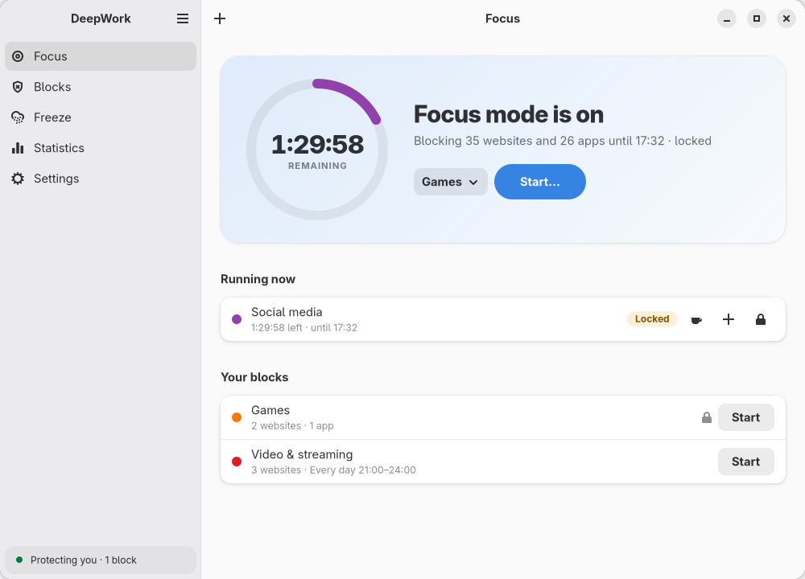
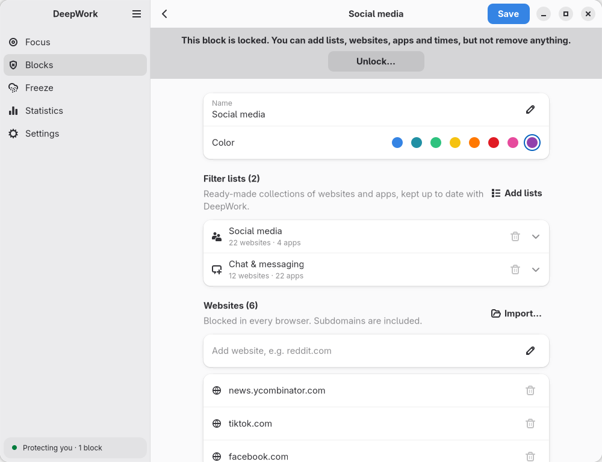
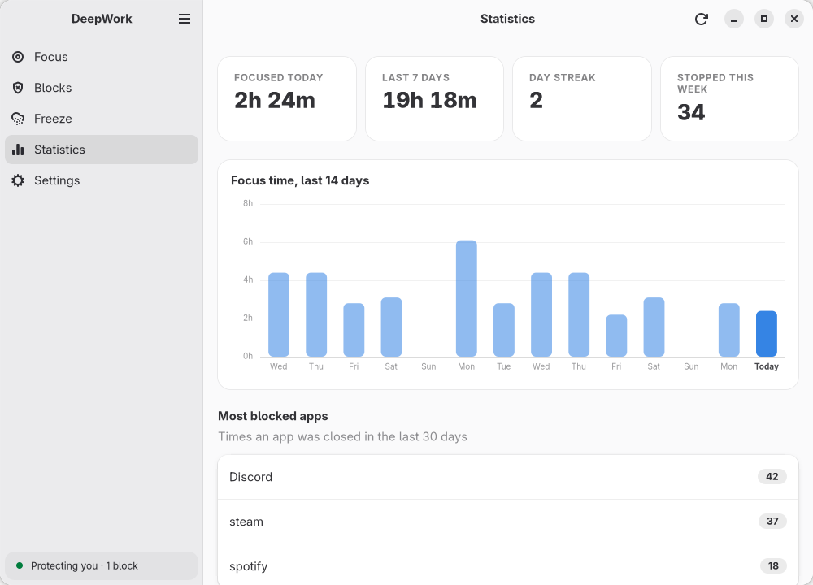
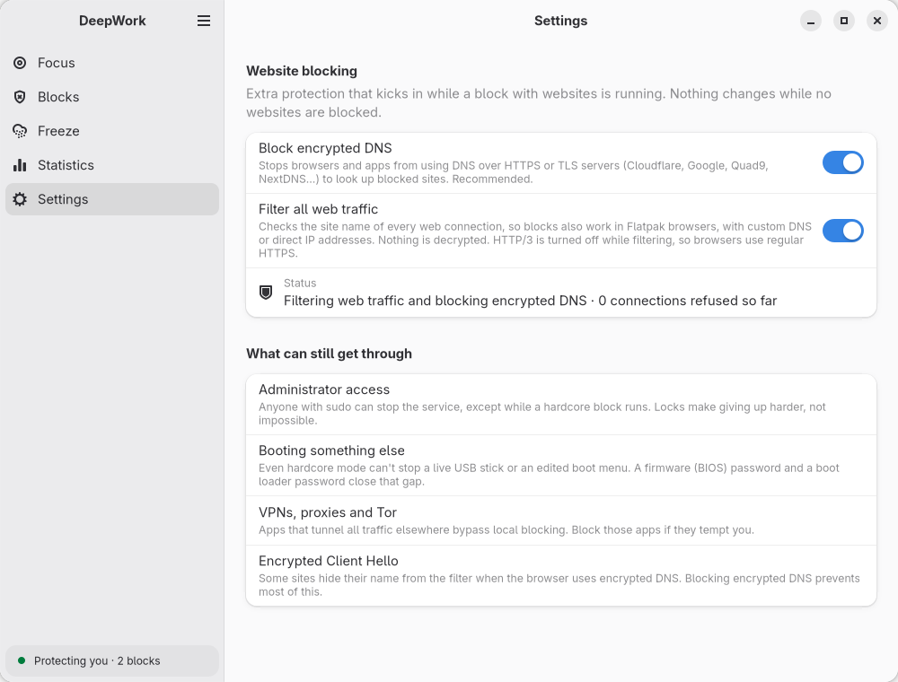
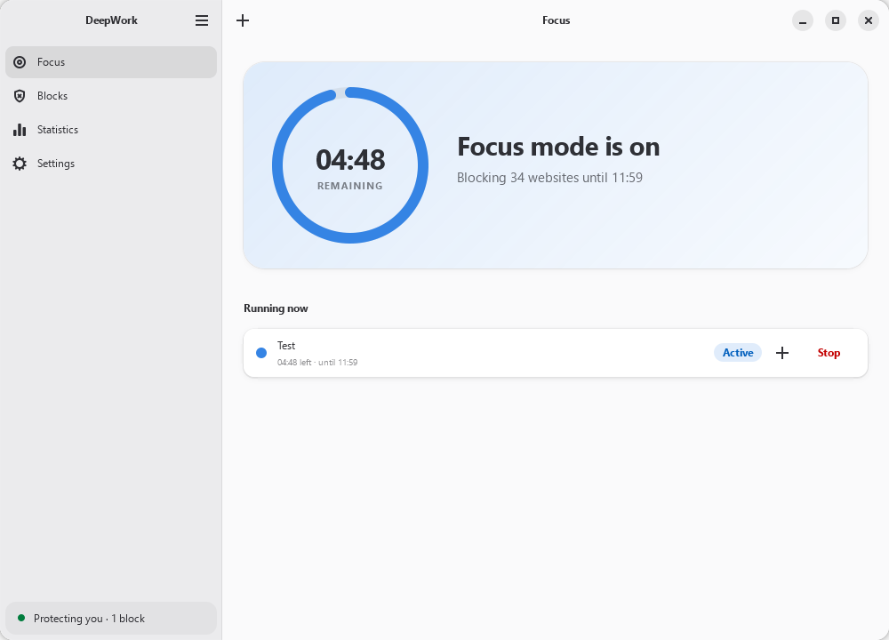

<p align="center"></p>

<h1 align="center">DeepWork</h1>

<p align="center">
  A website and app blocker for Linux and Windows with a GTK4 / libadwaita interface.<br>
  Block distractions on demand or on a schedule, and lock yourself in so you can't give up halfway through.
</p>

<p align="center">
  <a href="https://github.com/ichbinstudent/deepwork/actions/workflows/ci.yml"></a>
  <a href="LICENSE"></a>
</p>

<p align="center">
  
  
  
  
</p>

Inspired by [Cold Turkey Blocker](https://getcoldturkey.com) (not affiliated). DeepWork enforces its
blocks from a system service with administrator rights, so closing the app doesn't end a block.

DeepWork 0.x is in **beta**. [Supported systems, features per platform and known
limitations](docs/PLATFORMS.md) · [Troubleshooting](docs/TROUBLESHOOTING.md) ·
[Privacy](docs/PRIVACY.md) · [Security](SECURITY.md) · [Changelog](CHANGELOG.md) ·
[Releasing](docs/RELEASING.md)

## Features

- **Blocks**: named sets of websites and applications, each with its own color, schedule and lock.
- **Website blocking** in every browser through `/etc/hosts`. In Chrome, Chromium, Brave, Edge and
  Vivaldi it also uses an enterprise URL blocklist, so all subdomains are covered right away and the
  browser shows a proper "blocked" page. DNS-over-HTTPS is turned off so browsers can't get around
  the block. Firefox gets the same policies at its next start.
- **Encrypted DNS blocking** (on by default): while websites are blocked, well-known DNS-over-HTTPS/TLS
  servers are blocked by name and address for your apps. Browsers can't look up blocked sites
  around `/etc/hosts`. System services (e.g. systemd-resolved with DNS over TLS) are not affected.
- **HTTPS filtering** (optional, Settings page): while websites are blocked, your web traffic goes
  through a filter inside the service. It reads the site name of each connection (TLS SNI, or the
  `Host` of every plain-HTTP request) and refuses blocked sites. Nothing is decrypted and no
  certificate is installed. It works for any browser or app, including Flatpaks, custom DNS and
  direct IP addresses: connections that don't name their site (e.g. HTTPS to a bare IP address)
  are refused. Plain-HTTP requests get a "Blocked by DeepWork" page. HTTP/3 is turned off while
  filtering so browsers fall back to filterable HTTPS. If the filter can't run, the traffic it
  should check is refused, never let through.
- **App blocking**: blocked apps are closed as soon as they start, for every person's account on
  the computer (never root's or system services'). You can match an app by process
  name, executable path, or desktop/Flatpak app id. A picker lists installed and running apps.
  `cmd:<text>` rules match the full command line, e.g. `cmd:net.minecraft.client.main.Main` catches
  Minecraft whichever launcher started it.
- **Filter lists**: 15 ready-made lists of websites *and* apps:
  - Social media, Chat & messaging (Discord, Telegram, Signal, Slack…), Video & streaming
  - Music streaming, Games (Steam, Lutris, Heroic, plus Minecraft: Modrinth, Prism, CurseForge,
    ATLauncher, GDLauncher, MultiMC, PolyMC, HMCL, TLauncher… and the game itself), News, Shopping, Email
  - AI chatbots, Rabbit holes (wikis, IMDb…), Dating, Gambling, Adult content
  - VPNs & proxies (VPN apps, Tor, web proxy sites)
  - Web browsers (close every browser for offline work)

  A block includes a list by reference, so lists get new entries when DeepWork is updated.
  While a block is locked, lists can be added but not removed.
- **Import** your own website lists from a file: plain domains, hosts files (`0.0.0.0 example.com`)
  or adblock rules (`||example.com^`). Up to 20,000 websites per block.
- **Weekly schedule**: drag across a 7-day × 30-minute grid to choose when a block turns on.
- **Locks**:
  - *Random text*: type N random characters to unlock (pasting is disabled)
  - *Password*: somebody else keeps the password (after 5 wrong guesses, each next one has to
    wait, up to 5 minutes)
  - *Until restart*: unlocks only after a reboot
  - *Strict*: no way out until the time is up
  - *Hardcore*: strict, and nobody gets administrator rights while it runs (see below)
  - *Protect settings until a date*: no stopping, deleting or weakening the block before then
- **Locked means locked**: while a block is locked you can add sites, apps and schedule time, but
  you can't remove anything, shorten anything or change the lock. The rules are enforced by the
  service, not just hidden in the interface.
- **Breaks**: a daily allowance of minutes you may pause a block (even a locked one), and optional
  Pomodoro cycles (e.g. 25 minutes on, 5 minutes off).
- **Freeze**: lock the whole computer for a while. The screen keeps re-locking until the timer ends.
- **Statistics**: focus time per day, streaks, and the apps that were blocked most.
- **Top-bar indicator** with a live countdown and a menu to start blocks, add time,
  take a break, unlock, freeze, or open the app. The icon shows whether DeepWork is idle,
  blocking, locked, on a break, frozen, or the service is offline. On GNOME this needs the
  [AppIndicator extension](https://extensions.gnome.org/extension/615/appindicator-support/).
  KDE and most other desktops support it out of the box. The countdown can be hidden from the menu.
- **Notifications** when an app is blocked or a block starts or ends.
- **Clock-change protection**: changing the system clock doesn't end blocks early.
- **CLI**: `deepworkctl status | start <block> <min> | stop <block> | unlock <block> | freeze <min> | locked`,
  and `deepworkctl add <name> [--lock none|random|strict] <site|list:ID>… | delete <block> | lists` to
  manage blocks without the app.

## Hardcore mode

The other locks stop you from giving up inside DeepWork, but anyone with `sudo` can still stop the
service. A block with the **Hardcore** lock closes that gap while it runs:

- **No administrator rights for anyone.** A sudoers drop-in denies every `sudo` command (root
  itself excepted), `doas` gets a `deny` section, polkit asks for root's password for any admin
  action and refuses `pkexec`, `run0`, `systemctl`, package installs and clock changes outright,
  and root's password is locked so `su` and root logins fail.
- **No tunnels.** Traffic through VPN interfaces (WireGuard, tun, IP-in-IP, GRE) is refused, and the
  *VPNs & proxies* list is always included.
- **Network protections always on.** Encrypted-DNS blocking and HTTPS filtering are on whatever the
  Settings page says.
- **Strict.** There's no unlocking, and restarting the computer doesn't end it.

Everything is undone the moment the block ends, including root's password if it was locked. As a
safety net, a systemd timer (`deepwork-hardcore-release.timer`) runs a small shell script that gives
the rights back a minute after the deadline, even if the DeepWork service is broken.

To make sure administrator rights always come back for updates, hardcore blocks together can keep
them away for at most 7 days in a row (breaks of less than an hour don't count); then they come
back for at least an hour, while blocking goes on. Hardcore schedules must also leave some time
free every week. The block editor asks for
confirmation and warns if you're in a group such as `docker` that can still get root.

## Install

### Linux, from a release

The [releases](https://github.com/ichbinstudent/deepwork/releases) have packages for Debian and
Ubuntu (`.deb`) and Fedora (`.rpm`), which pull in what DeepWork needs and set up the service:

```sh
sudo apt install ./deepwork_<version>-1_amd64.deb      # Debian 13+, Ubuntu 25.04+
sudo dnf install ./deepwork-<version>-1.x86_64.rpm     # Fedora 42+
```

The user who runs the install through `sudo` (or `pkexec`, `run0`, `doas`) may control DeepWork;
add others with `sudo deepwork-daemon --allow-user <uid>` and `sudo systemctl restart deepwork`.
Installed from a root shell, only root may control it until you add someone. Removing the package
is refused while a block is locked; `apt purge` also deletes your blocks and statistics.

On other distributions, download `deepwork-<version>-linux-x86_64.tar.gz`, unpack it and run the
installer as your normal user (not root):

```sh
tar -xzf deepwork-*-linux-x86_64.tar.gz
cd deepwork-*-linux-x86_64
./install.sh          # uses sudo to install into /usr/local and start the service
```

The binaries need systemd, GTK ≥ 4.14 and libadwaita ≥ 1.7 (Debian 13, Ubuntu 25.04, Fedora 42,
Arch or newer); `nftables` for the encrypted-DNS blocking and HTTPS filtering.

### Linux, from source

Building needs Rust ≥ 1.92 (via [rustup](https://rustup.rs)) and the development packages:

| Distribution | Build dependencies |
| --- | --- |
| Arch, CachyOS, Manjaro | `sudo pacman -S --needed base-devel gtk4 libadwaita nftables` |
| Fedora 42+ | `sudo dnf install gcc pkgconf-pkg-config gtk4-devel libadwaita-devel nftables` |
| Debian 13+, Ubuntu 25.04+ | `sudo apt install build-essential pkg-config libgtk-4-dev libadwaita-1-dev nftables` |

Then, as your normal user (not root):

```sh
git clone https://github.com/ichbinstudent/deepwork.git
cd deepwork
./install.sh          # builds, then uses sudo to install into /usr/local and start the service
```

Only the user who ran `install.sh` (and root) may control the service. To allow others, add their
user ids (`id -u <name>`) to `allowed_users` in `/etc/deepwork/config.json` and run
`sudo systemctl restart deepwork`. Without that file, or with nobody in it, only root may.

This installs:

| What | Where |
| --- | --- |
| `deepwork` (app), `deepwork-daemon`, `deepworkctl` | `/usr/local/bin` |
| systemd service `deepwork.service` (runs as root) | `/etc/systemd/system` |
| desktop entry and icon | `/usr/local/share` |
| top-bar indicator autostart (`deepwork --background`) | `/etc/xdg/autostart` |
| who may control the service | `/etc/deepwork/config.json` (`allowed_users`) |
| blocks and statistics | `/var/lib/deepwork/state.json` |

To remove it, run `/usr/local/lib/deepwork/uninstall.sh` (it's also in the download). Add `--purge`
to also delete your data. Uninstalling is refused while a block is locked or a freeze is running.
The scripts use `sudo`, or `doas` or `run0` where there's no sudo (or whatever `SUDO=` names).

### Windows (beta)

Download and run **`deepwork-<version>-windows-x64-setup.exe`**, or `-arm64-setup.exe` on ARM PCs
(each installer refuses the other kind of PC). It asks for administrator rights, installs DeepWork
to `C:\Program Files\DeepWork`, adds it to the Start menu and to *Settings → Apps*, puts
`deepworkctl` on the PATH and starts the DeepWork service. From the next sign-in, DeepWork waits in
the notification area: click its icon to open it, right-click for a menu to start, extend or stop
blocks. To update, run the newer installer; your blocks, statistics and running locks are kept.
Installing an older version over a newer one is refused (uninstall first).

On Windows, DeepWork blocks websites through the hosts file and browser policies (Chrome, Edge, Brave
and Firefox), so proxy and VPN extensions in those browsers don't get around a block. App blocking,
Freeze, the network filter and the hardcore lock aren't available yet; the app leaves them out.
Everything also works from the command line:

```powershell
deepworkctl lists                         # built-in filter lists
deepworkctl add Social --lock strict list:social reddit.com
deepworkctl start Social 60
```

The service (`DeepWork` in *Services*) runs as SYSTEM, starts with Windows and is restarted if it
crashes or is killed. Blocks and settings live in `C:\ProgramData\DeepWork`, which only
administrators can change (and only they can read the blocks and lock passwords); the service logs
to `deepwork.log` there. Only the user who started the
installer (and administrators) may control it. To let another user in, run in an administrator
terminal `deepwork-daemon --allow-user <SID>` (their SID is in `whoami /user`) and restart the
service. Locks only stop standard users: an administrator can always stop the service.

Uninstall from *Settings → Apps*. It asks whether to delete your data too, and is refused while a
block is locked or a freeze is running.

<p align="center"></p>

For scripted installs: `setup.exe /VERYSILENT /SUPPRESSMSGBOXES /NORESTART [/USER=<SID>]
[/LOG=<file>]` (`/USER` picks who may control DeepWork, by default whoever started the installer),
and `"C:\Program Files\DeepWork\unins000.exe" /VERYSILENT /SUPPRESSMSGBOXES [/PURGE=1]`.
Without `/LOG` the installer still writes a log to `%TEMP%\Setup Log <date>.txt`.

Both packages are native builds, app included. DeepWork has had little testing on Windows so far. Please report what doesn't work.

## How it works

```
 deepwork (GTK app) ──┐
 deepworkctl (CLI) ───┴── JSON over /run/deepwork/deepwork.sock ──► deepwork-daemon (root)
                                                                     ├─ /etc/hosts section
                                                                     ├─ Chromium / Firefox policy files
                                                                     ├─ closes blocked processes
                                                                     ├─ nftables table `inet deepwork`
                                                                     │   (encrypted DNS, web redirect)
                                                                     ├─ SNI / Host filter on 127.0.0.1
                                                                     └─ loginctl lock-sessions (freeze)
```

- `crates/core`: data model, the locking and weakening rules, schedule maths and the wire protocol.
  Pure and unit-tested.
- `crates/daemon`: the privileged service. It runs the rules once a second, owns all state, and
  checks who is calling by the kernel's peer credentials.
- `crates/gui`: the libadwaita app and the top-bar indicator. It polls the daemon and never touches
  the system itself. While the indicator is up, closing the window keeps DeepWork running in the top
  bar; *Quit* in the menu exits it. Blocking carries on either way.

### Platforms

Everything that depends on the operating system sits behind traits in
`crates/daemon/src/platform/` (and `crates/gui/src/platform/` for the tray icon and app discovery).
The rules, state, schedules, hosts file format, browser policy contents, process matching and the
protocol are shared.

| Trait | What it does | Linux |
| --- | --- | --- |
| `System` | hosts file, DNS cache, cutting connections, screen lock, boot id | `/etc/hosts`, `resolvectl`, `ss -K`, `loginctl` |
| `ProcessTable` | list and close processes | `/proc`, signals |
| `NetGuard` | encrypted DNS, web filter, VPN tunnels | nftables + transparent SNI filter |
| `AdminLockout` | hardcore mode | sudoers, doas, polkit, root password |
| `Layout` (data) | where browsers read policies | Chromium JSON dirs, Firefox `policies.json` |

Each OS module builds a `Platform` from the pieces it has; a missing piece means the feature isn't
available there. The service reports this as `capabilities` in its status, refuses unsupported
requests, and the app hides or disables them (for example, unsupported lock types don't appear in
the lock menu).

| Feature | Linux | macOS | Windows |
| --- | --- | --- | --- |
| Website blocking (hosts file) | ✅ | ✅ (untested) | ✅ |
| Cutting off sites that are already open | ✅ | — | ✅ |
| Browser policies | ✅ | Firefox only (untested) | ✅ registry + Firefox |
| App blocking | ✅ | — | — |
| Encrypted DNS / HTTPS filter / VPN blocking | ✅ | — | — |
| Freeze | ✅ | — | — |
| *Until restart* lock | ✅ | ✅ (untested) | — |
| Hardcore lock | ✅ | — | — |
| Service ↔ app connection | Unix socket | Unix socket | named pipe |
| App | ✅ | — | ✅ |
| Tray icon | ✅ | — | ✅ |
| Running-app picker | ✅ | — | — |

The Windows backend is checked in CI, and an end-to-end test installs the package on x64 and ARM
Windows runners, blocks a site, checks the hosts file and Chrome's policy, screenshots the app and
uninstalls again. It hasn't been used on real machines much yet. The macOS backend compiles but has
never run, and CI doesn't check it. Each module's documentation lists what's still needed.

## Honest limitations

Anyone with root access can stop the service or edit `/etc/hosts`. The service restarts when killed,
re-applies the hosts file every few seconds, and keeps its entries while it's stopped. That puts real
friction in the way of quitting, but it can't make bypassing impossible on a machine you administer,
unless a hardcore block is running. Other limits:

- VPN apps, proxies and Tor tunnel traffic past local blocking. Block those apps if needed.
- With HTTPS filtering, a browser that uses Encrypted Client Hello hides the real site name. ECH
  needs encrypted DNS, which DeepWork blocks, so this is rare. Browsers can also reuse an existing
  HTTPS connection for a sibling domain on the same server (e.g. Google sites), and a server that
  hosts both an allowed and a blocked site may serve either over the same encrypted connection.
  Chrome's URL blocklist still covers Chrome.
- The firewall rules only exist while websites are blocked. They are removed when the service stops,
  so a crashed service never leaves your connection broken.
- `/etc/hosts` has no wildcards. Each blocked site also covers common subdomains (`www.`, `m.`,
  `old.`, …), the first 2,000 sites fully and the rest with `www.` only. Chromium-based browsers
  block all subdomains through policy, for up to 1,000 sites. Sites of locked blocks come first,
  so adding sites to a locked block never takes coverage away from the ones it had.
- Firefox reads policies only at start-up, so its URL filter takes effect after a restart. The
  hosts file works immediately.
- App blocking only covers processes of people's accounts (uid 1000 and up), never root, system
  services or core desktop programs. A program can't escape by calling itself `bash`: only the
  installed shells and desktop programs count as those.
- Hardcore mode can't stop someone who boots a live USB stick or edits the kernel command line in
  the boot menu. Set a firmware (BIOS) password and a boot loader password to close that. Members
  of groups such as `docker` or `disk` can also still get root.

## Development

```sh
cargo test --workspace
cargo clippy --workspace --all-targets -- -D warnings
cargo fmt --all

# Run the service unprivileged in a sandbox and point the app at it:
cargo run -p deepwork-daemon -- --sandbox /tmp/dw --socket /tmp/dw.sock &
DEEPWORK_SOCKET=/tmp/dw.sock cargo run -p deepwork
```

In `--sandbox` mode the daemon keeps its hosts file, policies and state under the given directory
and doesn't run system commands. It can still close your own processes that match a running block,
so don't put your editor in a test block. The network features only run as root (or with `--net`).

For screenshots, the app can open a page and render itself to a PNG, which also works headless with
GTK's Broadway backend:

```sh
DEEPWORK_DEBUG_PAGE=stats DEEPWORK_DEBUG_SIZE=1000x720 DEEPWORK_DEBUG_SHOT=/tmp/stats.png \
  DEEPWORK_SOCKET=/tmp/dw.sock cargo run -p deepwork
```

`DEEPWORK_DEBUG_OPEN=edit|start|unlock|apps|new` also opens a dialog first.

The CI workflow (`.github/workflows/ci.yml`) runs the format check, Clippy and the tests in an Arch
Linux container and on Windows, builds the Windows installers for x64 and ARM64, and tests them
end to end (install, block, update, uninstall) on Windows runners of both kinds.

Unit tests go in a `tests.rs` next to the code they test (`#[cfg(test)] mod tests;`), not inline.
CodeQL (`.github/workflows/codeql.yml`) skips those files, so test passwords and the like don't
show up as security findings.

## License

DeepWork is free software, licensed under the [GNU General Public License v3.0 or later](LICENSE).
